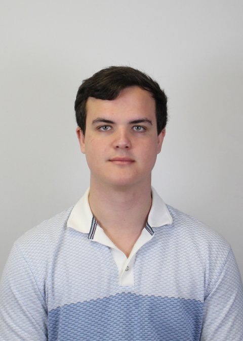

# Jarrod Stringer

**Biochemistry graduate | MSc AI in Bioscience student**

[GitHub](https://github.com/JStringer13) | [LinkedIn](https://www.linkedin.com/in/jarrod-stringer-592a8819b/)

## About me

I am a Biochemistry graduate from the University of Leeds, currently studying MSc AI in Bioscience at Queen Mary University of London. I am developing skills in programming, bioinformatics and biological data analysis, building on my scientific background.

My interests include molecular biology, pharmacology and how computational methods can support biological research. Alongside my studies, hospitality work, sports coaching and rugby captaincy have developed my teamwork, communication and ability to work under pressure.

[Find out more about my studies, interests and work experience](experience/experience.md).

## Education

| Qualification | Institution | Dates |
| --- | --- | --- |
| MSc AI in Bioscience - in progress | Queen Mary University of London | 2026-2027 |
| BSc (Hons) Biochemistry - 2:1 | University of Leeds | 2022-2025 |
| A levels (Biology, Chemistry, Math) - 3x A* | Hurstpierpoint College | 2019-2021 |

## Academic project

**Monoclonal antibody aggregation - undergraduate literature review**

My final-year dissertation examined the biochemical causes of monoclonal antibody aggregation, its implications for therapeutic development and manufacturing, and approaches to reducing aggregation. This developed my ability to evaluate research evidence, synthesise findings and communicate scientific ideas clearly.

## Skills

- **Scientific research:** Evaluated and brought together published findings through my dissertation and academic study.
- **Laboratory work:** Developed practical scientific skills and an understanding of experimental design through undergraduate laboratory training.
- **Programming and data analysis:** Used Python, Jupyter, pandas and Matplotlib in scientific programming exercises and a group dashboard project.
- **Bioinformatics:** Applied Linux workflows to biological sequence processing, genome assembly and variant analysis.
- **Version control and documentation:** Used Git, GitHub, Markdown and MkDocs to track changes, document work and maintain this portfolio.

## Work experience

| Role | Dates | Main responsibilities |
| --- | --- | --- |
| Chef, The New Inn | 2021-2022 2025-2026 | Food preparation, stock management, supplier coordination and maintaining food quality and hygiene in a busy kitchen. |
| Barista, Mama Bars | 2021 | Customer service, preparing food and drinks, handling payments and maintaining stock and cleanliness. |

## Coaching and leadership

- Hold a Level 2 Certificate in Coaching (Sport and Physical Activity), with experience delivering inclusive sports sessions for young people with autism and adapting activities to individual needs.
- Developed leadership and communication skills through rugby team captaincy and supporting teammates.